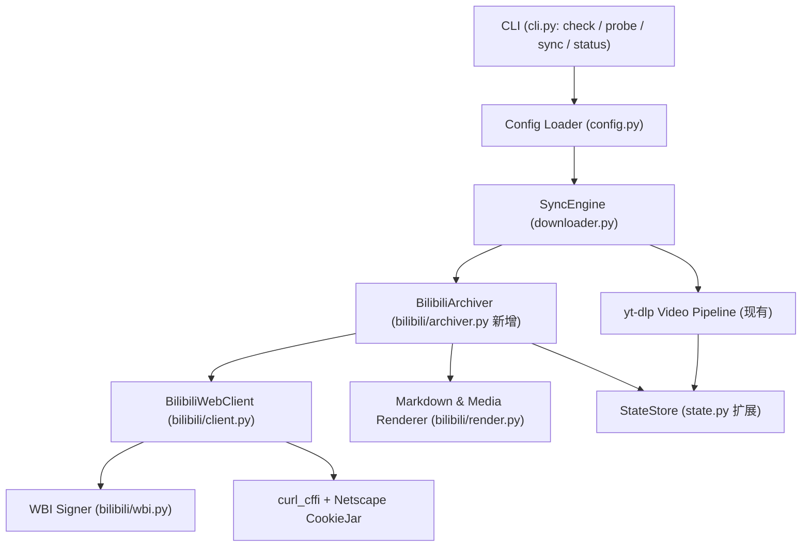

# PDR：B 站 UP 主全量内容离线归档系统（biliyt v0.2）

- **文档状态**：Draft v1.0（待评审确认后进入开发）
- **所属项目**：`biliyt`（`c:\WorkSpace\bli-youtube`）
- **基线版本**：`v0.1.0`（commit `6c469e9`）
- **适用平台**：Bilibili（保持 YouTube 现有能力与配置 100% 向下兼容）

---

## 1. 背景与目标

### 1.1 背景
当前 `biliyt v0.1.0` 已基于 `yt-dlp` 跑通 B 站 / YouTube 视频的批量增量下载、元数据、封面、字幕与弹幕归档。但在实际归档 B 站 UP 主（尤其是长视频/观点/研究类 UP 主）时，大量关键信息并不只在视频正片中，还分布在：
- **动态**（更新公告、勘误、长图文、转发点评）
- **专栏**（完整文稿、参考文献、深度图文）
- **评论区**（UP 主置顶勘误、作者补充回复、高赞讨论）
- **主页与合集/收藏夹**（账号身份快照、系列编排、推荐片单）

### 1.2 核心目标
1. **全形态覆盖**：围绕单个 B 站 UP 主目标，一站式归档「主页档案 + 投稿视频 + 动态 + 专栏 + 精选评论 + 公开收藏夹清单」。
2. **双格式落盘**：所有非视频内容同时保存 **原始 JSON（100% 数据保真，利于二次处理）** 与 **Markdown（图片全本地化，开箱离线可读）**。
3. **增量与幂等**：复用并扩展现有 `StateStore` 归档与失败重试机制，支持「首次历史全量回溯」与「日常增量更新」。
4. **风控优先**：内置 WBI 动态签名、请求随机节流与 `-352`/`-412` 熔断保护，避免高强度抓取导致 Cookie 失效或账号受限。
5. **平滑兼容**：不破坏现有 `config.yaml` 字段、CLI 命令和已有 `downloads/bilibili/<target_id>/` 下载目录。

---

## 2. 需求范围与边界

### 2.1 纳入范围（In Scope）

| 序号 | 内容模块 | 抓取范围 | 输出产物 | 优先级 |
| :---: | :--- | :--- | :--- | :---: |
| 1 | **主页档案 (`profile`)** | 昵称、UID、签名、认证、等级、粉丝/获赞快照、头像、主页横幅、公开合集/系列目录 | `profile.json`、`profile.md`、`avatar.*`、`banner.*`、`collections.json` | P0 |
| 2 | **投稿视频 (`videos`)** | 复用现有 `yt-dlp` 引擎：高画质音视频、封面、`.info.json`、CC/AI 字幕、可选 XML 弹幕 | 沿用现有视频产物格式 | P0（已有） |
| 3 | **动态 (`dynamics`)** | UP 主全部公开动态：纯文字、九宫格图、新版 Opus 图文、转发动态（含原动态快照）、关联视频/专栏/投票/预约卡片 | 每条动态独立目录或前缀：`.md` + `.json` + 本地原图（`images/`） | P0 |
| 4 | **专栏 (`articles`)** | 公开专栏列表及正文，同时兼容旧版 `cv` HTML 专栏与新版 Opus 专栏，记录所属文集 | 每篇专栏：`.md`（本地图片引用）+ `.json` + 本地原图 | P0 |
| 5 | **精选评论 (`comments`)** | 覆盖视频、动态、专栏三类载体；固定采用「**置顶评论 + UP 主回复 + 热门前 N 条（默认 50）**」策略 | 挂载在对应条目的 `.comments.json` + `.comments.md` | P0 |
| 6 | **公开收藏夹清单 (`favorites`)** | UP 主公开创建的收藏夹目录及夹内视频元数据清单（**不下载他人视频实体**） | 每个收藏夹：`<fav_id>.json` + `<fav_id>.md` | P1 |
| 7 | **音频投稿 (`audio`)** | 若 UP 主有音频区投稿（`au`），可选拉取清单或通过 `yt-dlp` 下载（默认关闭） | 音频文件 + `.info.json` | P2 |

### 2.2 明确排除（Out of Scope）
- **无权限内容**：未充电的充电专属视频/动态、未购买的付费课程、UP 主设为私密的收藏夹/动态。
- **平台已不可见内容**：已删除、审核下架、退稿内容。
- **直播实时录制**：不负责 7×24 直播流监控录制（建议由专用录播工具处理）。
- **无上限全量水评**：默认不做万级评论全量抓取，防止触发 B 站严格风控。

---

## 3. 系统架构与模块设计

### 3.1 总体架构



### 3.2 技术选型决策
- **自研轻量 B 站 Web API 客户端（基于项目已安装的 `curl_cffi`）**，而非引入第三方重型 SDK：
  - **零新增重依赖**：复用现有 `curl_cffi` 的浏览器 TLS 指纹、代理、Cookie 与超时控制。
  - **可控性强**：WBI 签名与核心 API 仅需 ~600 行清晰模块代码，接口变动时可直接定位修复，并易于编写离线 `pytest` 单测。

### 3.3 代码目录规划

在 `src/biliyt/` 下新增 `bilibili/` 子包，尽量减少对既有文件的侵入：

```text
src/biliyt/
├── cli.py                 # 扩展 --only / --content 过滤与分模块汇总展示
├── config.py              # 新增 BilibiliArchiveConfig / CommentArchiveConfig 配置模型
├── downloader.py          # SyncEngine 编排视频引擎 + BilibiliArchiver
├── state.py               # 扩展按模块分命名空间的归档读写与分模块 RunSummary
└── bilibili/
    ├── __init__.py
    ├── wbi.py             # nav 密钥拉取、混排编码、w_rid/wts 签名与缓存
    ├── client.py          # curl_cffi 会话、Cookie 加载、统一节流、错误码分类与熔断
    ├── models.py          # 动态/专栏/评论/收藏夹/主页内部数据结构
    ├── render.py          # Opus/HTML/动态/评论 -> Markdown 渲染 + 图片本地化下载
    └── archiver.py        # profile/dynamics/articles/favorites/comments 抓取与增量编排
```

---

## 4. 关键技术方案

### 4.1 WBI 签名与反风控机制（`wbi.py` & `client.py`）
1. **WBI 签名**：
   - 每次运行首次访问需要签名的接口前，请求 `https://api.bilibili.com/x/web-interface/nav`，提取 `wbi_img.img_url` 和 `wbi_img.sub_url` 的文件名拼接后，按 B 站固定 32 位混排表生成 `mixin_key`，缓存于客户端实例内存。
   - 签名时过滤参数值中的特殊字符 `!'()*`，追加 `wts`（当前 Unix 秒级时间戳），按 key 排序 URL 编码后拼接 `mixin_key` 计算 MD5 得到 `w_rid`。
2. **Cookie 复用**：
   - 直接读取 `ResolvedTarget.auth.cookies_file`（Netscape 格式），支持提取 `SESSDATA`、`bili_jct`、`buvid3`、`buvid4`、`DedeUserID` 等全量 Cookie。
   - 统一注入常规浏览器 `User-Agent` 及 `Referer: https://space.bilibili.com/<uid>/`。
3. **分级限流与熔断状态机**：
   - 每次 API 请求前按配置休眠随机间隔（默认 `1.5s–3.5s`）；图片下载按 `0.2s–0.6s` 轻量限流。
   - 响应码策略：
     - `code == 0`：正常处理。
     - `code in {-101, -111}`（未登录 / CSRF 失效）：标记鉴权错误并终止当前目标，提示刷新 Cookie。
     - `code in {-352, -412}` 或 HTTP `412`/`429`（风控触发）：触发**熔断器（Circuit Breaker）**——第 1 次退避休眠 `30s` 重试 1 次；若仍触发，立即中止当前 B 站 API 抓取、保存已成功项归档并记录断点到报告与 `failed.jsonl`，**严禁死循环硬撞**。

### 4.2 各内容模块接口与解析策略

| 模块 | 核心接口 | 分页与增量策略 | 解析要点 |
| :--- | :--- | :--- | :--- |
| **主页档案** | `x/space/wbi/acc/info`、`x/relation/stat`、`x/polymer/web-space/seasons_collections_list` | 每次同步覆盖更新最新快照，同时保留 `snapshots/` 历史变更（可选） | 头像与横幅下载至 `profile/` |
| **动态** | `x/polymer/web-dynamic/v1/feed/space`（`host_mid`, `offset`） | 游标 `offset` 向下翻页；**增量模式**遇到连续 2 条已归档且非置顶动态时提前停翻页（置顶动态可能出现在首条但时间戳较旧）；**全量模式**（`full_backfill` 或首次运行）翻到 `has_more=false` | 兼容 `DYNAMIC_TYPE_WORD`、`DRAW`、`ARTICLE`、`AV`、`FORWARD`、`LIVE_RCMD` 等；优先解析 `major.opus` 富文本节点与图片列表；转发动态递归渲染 `orig` 块 |
| **专栏** | `x/space/wbi/article`（分页列表）+ `x/polymer/web-dynamic/v1/opus/detail` / `read/cv<id>` 页面解析 | 按 `pn`/`ps` 翻页；归档键为 `cv<id>` 或 `opus_<id>` | 优先尝试 Opus 详情接口；若为传统 HTML 专栏，解析 `<div id="read-article-holder">` 并转 Markdown；文内图片全部下载到本地 `assets/` 并改写为相对路径 |
| **精选评论** | `x/v2/reply/wbi/main`（`oid`, `type`, `mode=3` 按热度）+ `x/v2/reply/reply`（楼中楼） | 每个载体抓 1–3 页热门评论直至集齐目标条数 | 详见 4.3 节精选评论算法 |
| **公开收藏夹** | `x/v3/fav/folder/created/list-all` + `x/v3/fav/resource/list` | 遍历 UP 主公开收藏夹，分页拉取夹内全部条目元数据 | 仅落盘 `.json` 与 `.md` 表格清单（含 BV、标题、原作者、时长、收藏时间、失效状态），**不触发视频下载** |

### 4.3 精选评论抓取算法（置顶 + UP 主回复 + 热门前 N 条）
对每个已下载/归档的视频（`type=1`）、图文/Opus 动态（`type=11` / `type=17`）、专栏（`type=12`）：
1. **置顶评论（必抓）**：提取响应中 `top.upper`（UP 主置顶）与 `top_replies`，并拉取其下全部 UP 主参与的楼中楼回复（最多 `max_sub_replies_per_root`，默认 20 条）。
2. **热门评论（前 N 条，默认 `N=50`）**：按热度排序（`mode=3`）翻页收集 `replies`，去重（排除已在置顶中的 `rpid`）取前 `N` 条主评论。
3. **UP 主回复（必抓）**：
   - 在已获取的热门主评论与置顶主评论中，检查每条主评论的 `up_action.reply == true` 或 `replies` 预览中是否包含 `mid == up_uid`；
   - 只要标记了 UP 主参与回复，就对该主评论补拉楼中楼（`x/v2/reply/reply`），优先完整保留 UP 主的回复及上下文。
   - 同时保留每条主评论自带的精选热评预览（通常 3 条）。
4. **节流与更新策略**：
   - 单载体评论抓取完成后写入 `comments` 归档（带抓取时间戳），默认不重复抓取旧条目的评论；支持通过 CLI 参数（如 `--refresh-comments`）按需刷新近期条目的评论区。

---

## 5. 配置模型扩展设计（`config.yaml`）

在 `PlatformConfig`（全局平台级）与 `TargetConfig`（单目标级）中新增可选的 `bilibili_archive` 字段，支持沿用现有的「全局默认 → 平台默认 → 单目标覆盖」三层合并逻辑：

```yaml
platforms:
  bilibili:
    proxy: null
    auth:
      cookies_file: "./cookies/bilibili.txt"
    archive:
      # 内容布局：grouped（按子目录分类）| flat（视频保持根目录，扩展内容放子目录，默认兼容旧目录）
      layout: "flat"
      # 模块开关
      profile: true
      videos: true
      dynamics: true
      articles: true
      favorites: true          # 仅存收藏夹视频清单（JSON + MD），不下载他人视频
      audio: false
      # 动态与专栏单次增量检查上限（null 表示全量回溯）
      dynamics_limit: 50
      articles_limit: 50
      # 是否下载动态/专栏中的原图到本地
      download_images: true
      # API 请求限速（独立于 yt-dlp 视频下载限速）
      api_sleep_min: 1.5
      api_sleep_max: 3.5
      # 精选评论配置
      comments:
        enabled: true
        targets: ["videos", "dynamics", "articles"]
        strategy: "up_and_top" # up_and_top（置顶 + UP主回复 + 热门前N）| off
        top_n: 50
        include_pinned: true
        include_up_replies: true
        max_sub_replies_per_root: 20
```

**向后兼容保证**：
- 若现有 `config.yaml` 未配置 `archive` 字段，默认仅保持原有行为（`videos: true`，其余模块 `false`），确保现有 32 个单元测试与老用户工作流零破坏；新模板 `config.example.yaml` 中明确注释展示全量归档配置。

---

## 6. 落盘目录与状态持久化规范

### 6.1 下载目录结构（`layout: flat` 兼容模式）
为了不移动已经下载到 `downloads/bilibili/bili_23191782/` 的现有视频文件，默认采用无缝共存目录：

```text
downloads/bilibili/<target_id>/
├── 2026-08-27 - 视频标题 [BV1S8hA6MEvy].mp4          # 现有视频（flat 模式下保持原位）
├── 2026-08-27 - 视频标题 [BV1S8hA6MEvy].info.json
├── 2026-08-27 - 视频标题 [BV1S8hA6MEvy].ai-zh.srt
├── 2026-08-27 - 视频标题 [BV1S8hA6MEvy].jpg
├── 2026-08-27 - 视频标题 [BV1S8hA6MEvy].comments.json # 视频精选评论（与视频同前缀）
├── 2026-08-27 - 视频标题 [BV1S8hA6MEvy].comments.md
├── profile/
│   ├── profile.json
│   ├── profile.md
│   ├── collections.json
│   ├── avatar.jpg
│   └── banner.jpg
├── dynamics/
│   └── 2026-08-27 - <dynamic_id>/
│       ├── dynamic.md                                # Markdown 正文（相对路径引用本地图）
│       ├── dynamic.json                              # B 站原始接口数据
│       ├── comments.json
│       ├── comments.md
│       └── images/
│           ├── 01_<hash>.jpg
│           └── 02_<hash>.png
├── articles/
│   └── 2026-08-10 - 专栏标题 [cv12345678]/
│       ├── article.md
│       ├── article.json
│       ├── comments.json
│       ├── comments.md
│       └── images/
│           └── 01_<hash>.jpg
└── favorites/
    ├── index.md                                      # 收藏夹总览索引
    ├── fav_<media_id>_<收藏夹名>.json
    └── fav_<media_id>_<收藏夹名>.md                  # 视频清单表格（无视频实体）
```

### 6.2 状态归档扩展（`state/`）
沿用 `StateStore`，按模块拆分纯文本归档文件，避免与 `yt-dlp` 自身写入的 `<target_id>.txt` 互相干扰：
- `state/archives/<target_id>.txt`（保留给 `yt-dlp` 视频归档）
- `state/archives/<target_id>.dynamics.txt`（每行一个 `dynamic_id`）
- `state/archives/<target_id>.articles.txt`（每行一个 `cv<id>` 或 `opus_<id>`）
- `state/archives/<target_id>.comments.txt`（每行 `<kind>:<oid> <fetched_at_iso>`）
- `state/failed.jsonl`：扩展 `item_type` 字段（默认 `"video"`，新增 `"dynamic" | "article" | "comment" | "favorite"`），统一支持 `biliyt sync --retry-failed`。

---

## 7. CLI 交互与运行报告扩展

现有 5 个命令保持不变，在 `probe` / `sync` / `status` 中增加模块维度参数与统计：
- `biliyt probe --target bili_23191782`：除视频外，同步探查并展示动态、专栏、公开收藏夹的发现数与待归档数。
- `biliyt sync --target bili_23191782 --only dynamics,articles`：新增可选 `--only`（`profile,videos,dynamics,articles,favorites,comments`），方便分模块增量或首次分批建档。
- `biliyt sync --target bili_23191782 --full`：全量回溯开关（忽略增量早停与 `*_limit`，翻页到底）。
- `biliyt status`：展示每个目标下视频 / 动态 / 专栏 / 评论的累计归档数与失败队列数。

---

## 8. 里程碑与测试验收标准

### 8.1 开发里程碑
- **M1：基础底座（配置 + WBI + API 客户端）**
  - 完成 `config.py` 扩展、`bilibili/wbi.py`、`bilibili/client.py`（含节流与熔断）。
  - 单测覆盖 WBI 签名向量、Cookie 解析、`-352`/`-412` 熔断行为、老配置兼容性。
- **M2：主页 + 动态 + 专栏 + 收藏夹清单**
  - 完成 `bilibili/render.py` 与 `bilibili/archiver.py` 的 `profile` / `dynamics` / `articles` / `favorites`。
  - 单测覆盖 Opus 富文本、转发动态、旧 `cv` HTML 转 Markdown、本地图片路径重写、收藏夹清单渲染。
- **M3：精选评论引擎**
  - 实现「置顶 + UP 主回复 + 热门前 N 条」合并去重与楼中楼补拉，支持视频/动态/专栏三类挂载。
  - 单测覆盖置顶去重、UP 主回复识别与上限截断。
- **M4：CLI 集成 + 实测验收 + 文档更新**
  - 接入 `SyncEngine`、`StateStore`、`cli.py` 与运行报告。
  - 以 `https://space.bilibili.com/23191782` 为实测目标完成端到端验收，更新 `README.md` 与 `docs/configuration.md`。

### 8.2 验收标准（Definition of Done）
1. 原有 `pytest` 32 项全部通过，新增单元测试 ≥ 25 项且全绿。
2. 对目标 `23191782` 执行小批量全模块实测（`--limit 2`）：
   - `profile/`、`dynamics/`、`articles/`、`favorites/` 及视频 `.comments.md`/`.comments.json` 均正确落盘；
   - Markdown 中所有图片均为有效本地相对路径且离线可打开；
   - 收藏夹目录下仅存在 `.json`/`.md` 清单，无第三方视频 `.mp4` 文件。
3. 立即执行第二次 `biliyt sync --target bili_23191782 --limit 2`，各模块新增下载数均为 `0`（验证增量幂等性）。
4. 触发模拟 `-352` 风控错误时，任务按设计休眠重试后安全熔断退出，不丢失已归档状态，且错误项正确记入 `state/failed.jsonl`。
